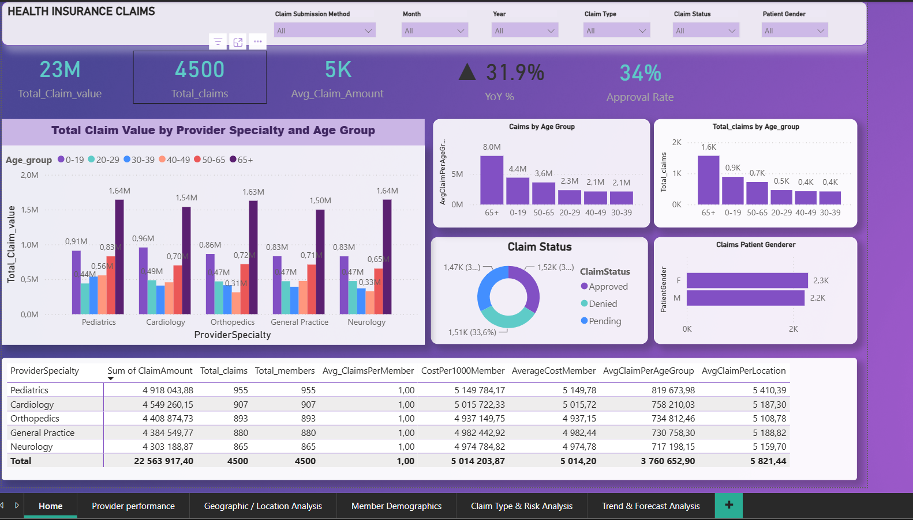

# Healthcare Claims Analytics

An end-to-end healthcare analytics project focused on analysing medical insurance claims, provider performance, member demographics and healthcare expenditure.

## Project Overview

This project explores healthcare insurance claims data to uncover trends, identify potential data-quality issues and provide actionable business insights through interactive Power BI dashboards.

The solution demonstrates practical skills in SQL, data transformation, data modelling, DAX and business intelligence reporting.

## Business Objectives

- Analyse total claims value and claims volume.
- Evaluate provider specialty performance.
- Monitor claim approval and rejection rates.
- Identify claim trends across age groups and demographics.
- Analyse average claim expenditure.
- Identify data-quality issues and unusual claims patterns.
- Support business decisions through interactive reporting.

## Dashboard Preview

## Technology Stack

| Technology | Purpose |
|---|---|
| SQL | Data transformation and validation |
| Power BI | Interactive dashboards |
| DAX | Business metrics and calculations |
| Microsoft Fabric | Data engineering and analytics (planned) |
| GitHub | Version control and documentation |

## Dashboard Modules

1. Home – Executive claims overview.
2. Provider Performance – Claims by provider specialty.
3. Geographic Analysis – Claims across locations.
4. Member Demographics – Claims by member demographics.
5. Claim Type & Risk Analysis – Claim patterns and risk indicators.
6. Trend & Forecast Analysis – Historical trends and forecasting.

## Data Quality

The project will incorporate realistic data-quality scenarios, including:

- Duplicate records.
- Missing values.
- Reversed claims.
- Payments outside benefit periods.
- Invalid or inconsistent records.

## Repository Structure

- `data/` – Synthetic datasets.
- `sql/` – SQL scripts and data-quality checks.
- `power-bi/` – Power BI report and DAX documentation.
- `documentation/` – Architecture, data dictionary and data model.

## Disclaimer

This project uses synthetic healthcare data for educational and portfolio purposes. No real patient or member information is included.

## Author

**Saneliso Mzwakali**

BI Developer | Data Analytics | SQL | Power BI | Microsoft Fabric
